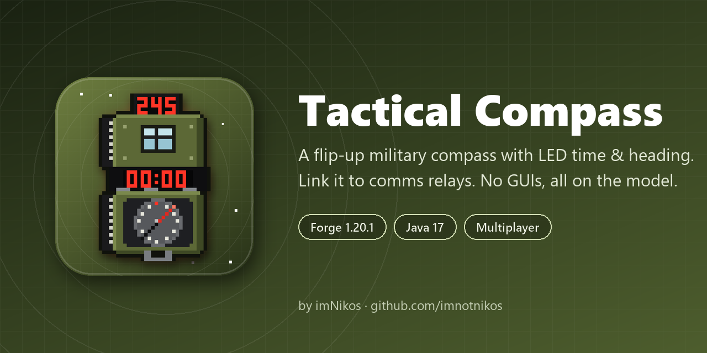
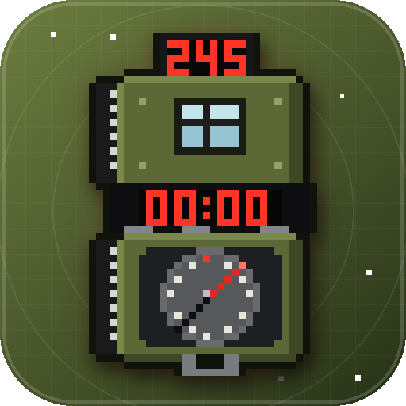

<p align="center"></p>

# Tactical Compass
Tactical Compass is a **Forge** mod for Minecraft 1.20.1 that adds a flip-up military compass and a deployable communications relay. The compass shows the in-game time on an LED display, gives your exact heading when you raise it, and can be linked to a relay so the needle points straight at it. Every readout is drawn on the item model itself — there are no GUIs, no overlays and no chat messages.



***
### Mod made by imNikos.
 
[](https://discord.gg/9xJgzNqEaJ)
[](https://instagram.com/imnikos_)
[](https://youtube.com/@imnikoss)
[](https://tiktok.com/@imnikos_)
[](https://github.com/imnotnikos)
[](https://modrinth.com/user/imNikos)
[](https://www.curseforge.com/members/imnotnikos/projects)

***

## Features
**Flip-Up Compass**: Equip the compass and it rises into your hand closed, then the lid flips open on its hinge with a little snap.

**Always Points North**: The rotating dial card keeps N aimed at true north, with 5° tick marks and numbered bearings every 30°.

**LED Time Display**: The inside of the lid shows the in-game time (00:00 – 24:00) on an 8-segment LED display with a blinking colon. Dimensions without a day cycle (Nether, End) show `--:--`.

**Raise to Read**: Hold right-click to bring the compass up close. The lid swings back, the crosshair lines up with the sight window, and a heading module pops up above it showing your exact bearing (000° – 359°).

**Communications Relay**: A rugged-case field relay with an animated radar screen, keyboard, radio set, toggle switches and blinking status LEDs. It is placed facing you, and right-clicking it opens or closes the lid with a chest-style animation (the antenna folds down inside when it closes).

**Relay Linking**: Right-click a relay with the compass to lock the needle onto it, like a lodestone. Right-click the same relay again to unlink. A LINK lamp on the bezel lights up while linked, the needle spins if the relay is in another dimension, and the link clears itself if the relay is broken.

**Three Colourways**: Every item comes in Black with blue LEDs, Olive with red LEDs, and Camo with green LEDs.

**No GUIs**: Everything — time, heading, link status — lives on the item and block models. Nothing is added to your screen or chat.

**Multiplayer Ready**: Other players see your compass flip open, see you raise it to read, and see relay lids swing. Links are stored on the item, so they survive restarts and trading.

## Controls

**Compass**

Right-click a relay – Link the compass to that relay (right-click it again to unlink).

Hold right-click anywhere else – Raise the compass to read the heading.

Sneak + right-click a relay – Does nothing to the relay (raises the compass instead).

**Communications Relay**

Right-click with an empty hand or any item (except the compass) – Open / close the case.

Sneak + right-click – Never touches the case, so you can place blocks against it like a chest.

## Items & Blocks
| Item | Variants |
| --- | --- |
| Tactical Compass | Black (blue LED), Olive (red LED), Camo (green LED) |
| Communications Relay | Black (blue LED), Olive (red LED), Camo (green LED) |

All six are in the **Tactical Compass** creative tab.

## Crafting
**Tactical Compass** (shaped)

```
[Dye]        [Iron ingot] [Redstone]
[Iron ingot] [Compass]    [Iron ingot]
[ empty ]    [Iron ingot] [ empty ]
```

**Communications Relay** (shapeless): Dye + Compass + Redstone torch + Block of iron.

The dye picks the colourway, and the dye slot can be left empty:

| Dye | Colourway |
| --- | --- |
| None | Olive (red LED) |
| Green dye | Olive (red LED) |
| Black dye | Black (blue LED) |
| Brown dye | Camo (green LED) |

**Re-dyeing**: Put any compass or relay in the crafting grid with a black, green or brown dye to switch it to that colourway. A compass keeps its relay link. An item can't be dyed into the colour it already is.

## Requirements
Minecraft **1.20.1** with **Forge 47.x** (built against 47.4.28).

Java 17.

Install on **both** the client and the server.

# Installation
## For Players
Navigate to the Releases page (or Modrinth / CurseForge).

Download the latest tacticalcompass jar.

Place the file into your `.minecraft/mods/` folder.

Launch Minecraft with the Forge 1.20.1 profile.

## For Server Owners
Place the same jar into your server's `/mods/` directory and restart. Every player who joins needs the mod installed too.

## Building
Requires JDK 17. Gradle is provided by the wrapper.

    ./gradlew build

Output: `build/libs/tacticalcompass-1.0.0.jar`

To test in a dev client:

    ./gradlew runClient

## Regenerating Art
All models, textures and data files are generated, so the look can be retuned without hand-editing JSON.

    python tools/gen_assets.py      # models, textures, blockstates, recipes, loot tables, lang
    python tools/gen_branding.py    # assets/icon.png, assets/social-preview.png, in-game logo

Requires Python 3 with Pillow.

## License
Released under the [MIT License](LICENSE).
